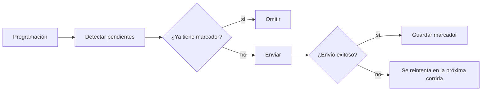

# Plantillas de n8n para operaciones

Tres flujos listos para importar: alertas sin duplicados, resumen diario y sincronización controlada desde Google Sheets.

Están pensados para una comunidad o negocio con miembros, pero el patrón sirve para cualquier operación que no pueda enviar dos veces el mismo mensaje.

> Son la versión genérica de automatizaciones que construí para operar una comunidad real. Los datos son ficticios.

## El problema

Un flujo programado se ejecuta muchas veces y a veces falla a la mitad. Sin control, eso produce mensajes repetidos o, peor, alertas perdidas. Y cuando personas editan una hoja de cálculo, un cambio descuidado puede dañar la base de datos.

## Las plantillas

| Plantilla | Qué hace | Patrón |
|---|---|---|
| [`alertas-sin-duplicados`](plantillas/alertas-sin-duplicados.json) | Avisa de vencimientos y falta de seguimiento | Marcador por alerta, guardado después de enviar |
| [`resumen-diario`](plantillas/resumen-diario.json) | Envía un resumen una vez al día | Marcador único por fecha |
| [`sincronizacion-sheets`](plantillas/sincronizacion-sheets.json) | Lleva cambios de Google Sheets a PostgreSQL | Solo acepta campos autorizados y valida cada fila |

## Cómo evita los duplicados



El orden importa: el marcador se guarda **después** del envío. Si lo guardara antes, un fallo marcaría la alerta como enviada y nunca llegaría.

## Instalación

1. Crea las tablas en PostgreSQL con [`sql/esquema.sql`](sql/esquema.sql). Puedes cargar datos ficticios con [`sql/datos-ejemplo.sql`](sql/datos-ejemplo.sql).
2. Importa los archivos de `plantillas/` en n8n.
3. Asigna tus credenciales de PostgreSQL y, para la sincronización, de Google Sheets.
4. Define las variables de entorno:

| Variable | Uso |
|---|---|
| `MENSAJES_URL` | Endpoint que recibe `{ telefono, texto }` por POST |
| `MENSAJES_TOKEN` | Token Bearer para ese endpoint |
| `REPORTE_TELEFONO` | Destino del resumen diario |
| `HOJA_ID` | ID de la hoja de Google Sheets |

> **Importante:** n8n 2 bloquea `$env` por defecto. Si no cambias esto, los flujos no enviarán mensajes. Define `N8N_BLOCK_ENV_ACCESS_IN_NODE=false`, o reemplaza esas expresiones por credenciales o valores propios.

La hoja debe llamarse `Seguimiento` y tener las columnas `id`, `responsable`, `notas` y `ultimo_seguimiento`.

## Decisiones técnicas

- **Lógica probada fuera de n8n:** el código de los nodos vive en `codigo/` y `scripts/construir.js` lo incrusta en las plantillas.
- **SQL parametrizado:** los datos viajan como un solo parámetro JSON, y Postgres los lee con `jsonb_to_recordset`. No se arma SQL con texto.
- **Columnas protegidas:** la hoja solo puede modificar `responsable`, `notas` y `ultimo_seguimiento`.
- **Claves deterministas:** una alerta incluye el miembro y su fecha, así que una renovación genera una alerta nueva.
- **Canal desacoplado:** el envío usa una petición HTTP genérica, sin depender de un proveedor.
- **Consultas sin resultados:** los nodos de PostgreSQL usan `alwaysOutputData`, porque n8n detiene el flujo si un nodo no devuelve filas.

## Verificación

```bash
npm install
npm test
```

Las 21 pruebas cubren la lógica, las consultas sobre un PostgreSQL real embebido (PGlite) y la estructura de las plantillas.

Además, ejecuté `alertas-sin-duplicados` y `resumen-diario` en n8n 2.14 con PostgreSQL 17 y un servicio de mensajes de prueba, simulando un fallo en el primer envío:

| Corrida | Resultado |
|---|---|
| Alertas 1 | Intenta 2 envíos; el que falla no guarda marcador |
| Alertas 2 | Reenvía solo la alerta fallida |
| Alertas 3 | No envía nada |
| Resumen, 2 corridas seguidas | Un solo marcador; si el primer envío falla, la siguiente corrida lo reintenta |

**Sin probar:** la plantilla de sincronización no se ejecutó contra Google Sheets real. Sí se importó en n8n, y están probadas su validación y su consulta SQL.

## Modificar las plantillas

Edita `codigo/` o `sql/consultas.js`, y regenera los archivos:

```bash
npm run construir
```

## Estructura

```text
plantillas/  Flujos listos para importar
codigo/      Lógica de los nodos, con pruebas
sql/         Esquema, datos de ejemplo y consultas
scripts/     Generador de plantillas
test/        Pruebas
```

## Licencia

[MIT](LICENSE)
